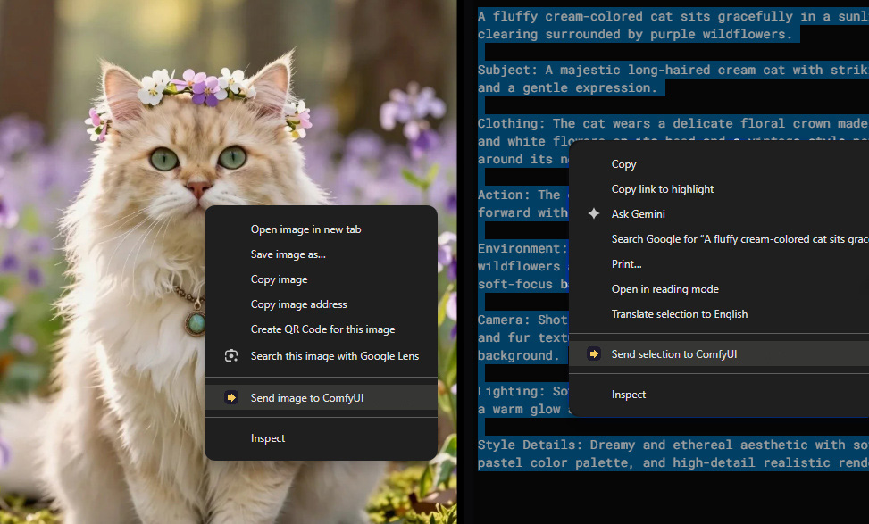
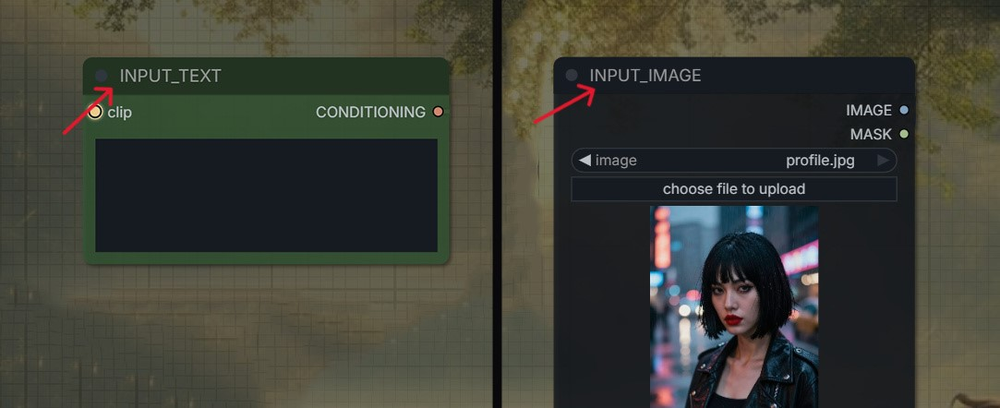
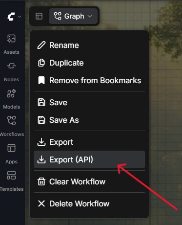
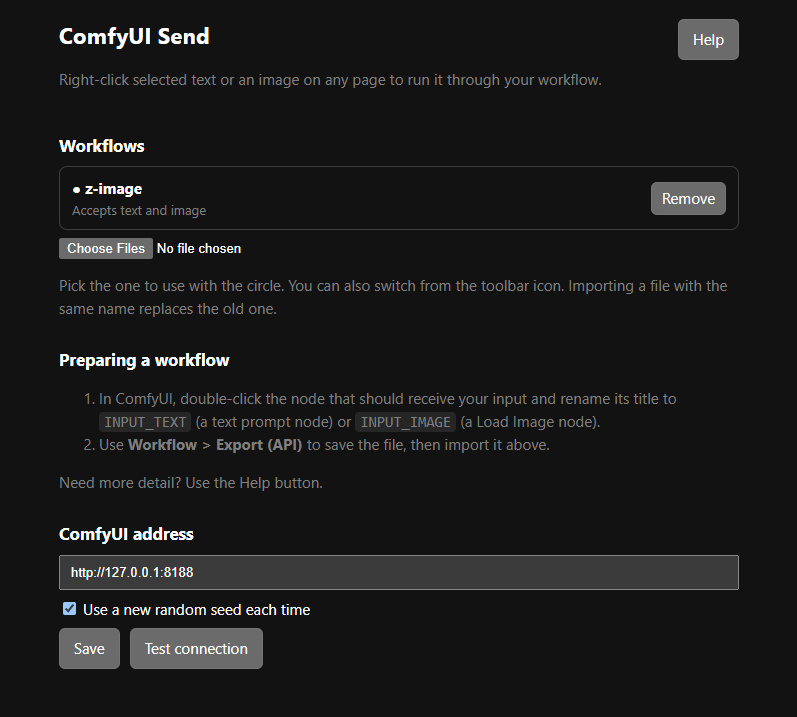

# ComfyUI Send

A browser extension to send selected text or image to ComfyUI queue with a right-click.

Right-click, pick the option, and the workflow is queued. Results show up in ComfyUI's history and wherever your workflow's output node saves them (`ComfyUI/output/` for Save Image, `ComfyUI/temp/` for Preview Image).



Works in Chrome, Edge, and Brave and other chromium browsers.

## Install

This extension is not on the Chrome Web Store, because its core feature needs broad permissions (see [Permissions](#permissions)). Install it manually:

1. Download or clone this repository.
2. Open `chrome://extensions` and turn on **Developer mode**.
3. Click **Load unpacked** and choose the extension folder (the one that contains `manifest.json`).
4. The settings page opens. Import a workflow (see below).

To update, replace the files and click the reload icon on the extension's card in `chrome://extensions`.

## Prepare a workflow

The extension fills in your input by looking for nodes with specific titles.

1. In ComfyUI, double-click the title of the node that should receive your input and rename it:
   - `INPUT_TEXT` for a text prompt node (for example, CLIP Text Encode).
   - `INPUT_IMAGE` for a Load Image node.
   - 
2. Export the workflow with **Workflow > Export (API)**. The regular save format will not work.
   - 
3. In the extension settings, import the exported `.json` file under **Workflows**.

Rules:

- Use at most one `INPUT_TEXT` node and one `INPUT_IMAGE` node per workflow.
- A workflow needs at least one of them.
- Everything else in the workflow stays exactly as exported.

If the file is rejected, the settings page tells you why.

## Multiple workflows

- You can import several files at once. Each is named after its file.
- Importing a file with the same name replaces the old one.
- Pick the current workflow in the settings list, or from the toolbar icon.
- The right-click menu always uses the current workflow and shows its name.

## Use it

- **Text:** select text on any page, right-click, then **Send selection to ComfyUI**.
- **Image:** right-click an image, then **Send image to ComfyUI**. The image is uploaded to ComfyUI first, then the workflow is queued.

A notification confirms it was queued, or explains what went wrong. The extension does not show or wait for the result.

Only the options your current workflow supports appear in the menu.

## Settings



- **ComfyUI address:** where ComfyUI is running. The default is `http://127.0.0.1:8188`.
- **New random seed each time:** replaces `seed` and `noise_seed` values before every send, so repeated runs give new images.
- **Test connection:** checks that the extension can reach ComfyUI.

## Troubleshooting

**"Could not reach ComfyUI"**
ComfyUI isn't running, or the address is wrong. Check the address in settings and use **Test connection**.

**The workflow is rejected by ComfyUI (validation errors)**
This usually means the workflow has a missing model or an unconnected input. Confirm the same workflow runs normally in ComfyUI first. If it runs there but fails after export, nodes that connect things implicitly (such as Anything Everywhere) or subgraphs may not export cleanly. Connect the nodes directly, unpack subgraphs, and export again with **Export (API)**.

**"ComfyUI refused the request (HTTP 403)"**
ComfyUI blocks requests from other origins. The extension normally removes the header that triggers this, but if your setup still gets blocked, restart ComfyUI once with:

```
python main.py --enable-cors-header "chrome-extension://YOUR_EXTENSION_ID"
```

You can find your extension ID on its card in `chrome://extensions`, and the error message also shows it.

**Image could not be downloaded**
Some sites block downloads, and temporary in-page (`blob:`) images can't be read. Save the image and load it into ComfyUI manually instead.

## Permissions

| Permission              | Why                                                                                                               |
| ----------------------- | ----------------------------------------------------------------------------------------------------------------- |
| `contextMenus`          | Adds the right-click options                                                                                      |
| `storage`               | Saves your workflows and settings                                                                                 |
| `notifications`         | Shows "queued" and error messages                                                                                 |
| `declarativeNetRequest` | Removes the `Origin` header from this extension's own requests to ComfyUI, so ComfyUI's origin check accepts them |
| All sites               | Lets the extension download the image you right-click, from whichever site it's on                                |

Selected text and images are sent only to the ComfyUI address you configure. Nothing else is sent anywhere, and there is no tracking.
